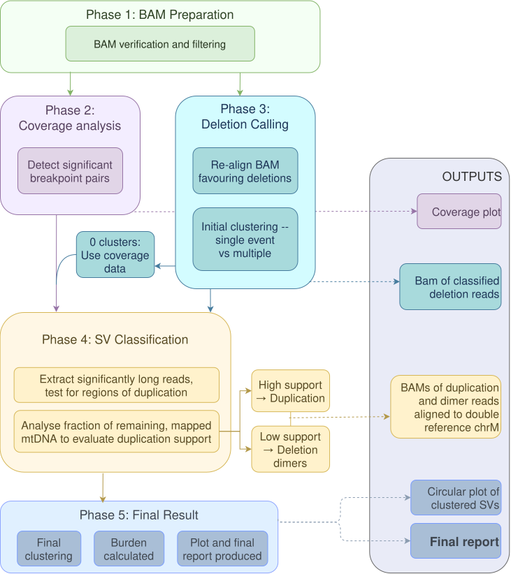
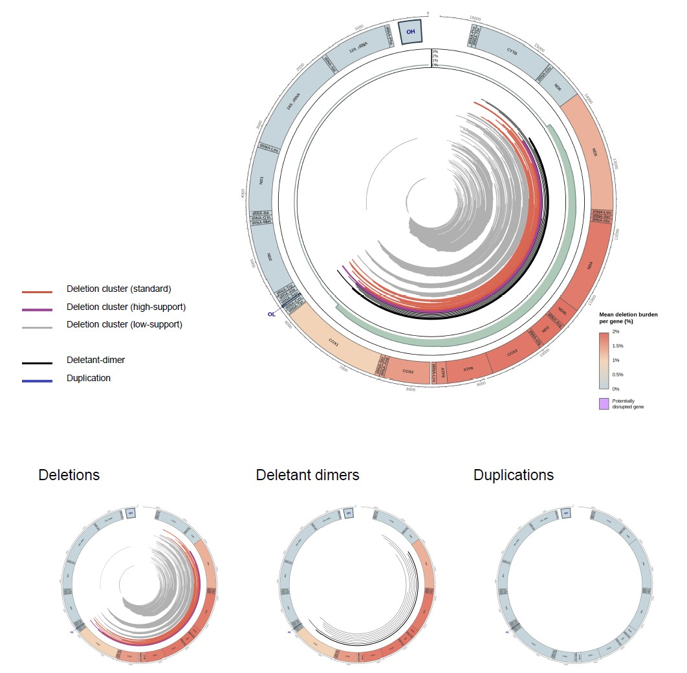

# MitoDetective

**An optimised large-scale rearrangement caller for long-read sequencing of mitochondrial DNA.**

MitoDetective detects, classifies, visualises and quantifies large-scale rearrangements (LSRs) of mitochondrial DNA from Oxford Nanopore and PacBio long-read sequencing data. By examining the architecture of individual reads, it distinguishes single and multiple deletions, duplications and deletion dimers, and reports per-gene deletion burden with publication-quality plots.

> This repository is the public landing page for MitoDetective. The source code is held in a separate repository, and access is granted on registration (see [Getting access](#getting-access)).

---

## Getting access

MitoDetective is **free for academic and non-commercial use**.

1. Register via UCL Ventures on the XIP platform: **https://xip.uclventures.com/products**
2. Once your registration is approved, you'll be invited to the source code repository on GitHub.

Registration requires an institutional email address.

**Commercial use** requires a licence from UCL Ventures. Please enquire via https://xip.uclventures.com/products.

## Licence

MitoDetective is released under the XIP Non-commercial licence for academic and non-commercial use. See [LICENSE](LICENSE) for the full terms. Commercial use is not permitted under this licence; a commercial licence is available from UCL Ventures.

## Features

- Works with Oxford Nanopore (ONT) and PacBio (PB) long-read data
- Supports human and mouse mtDNA
- Accepts whole-genome or chrM-only BAM files
- Single-sample or batch runs, with mixed platforms and species in one batch
- Read-level classification of each sample as:
  - no LSR detected
  - single deletion
  - single duplication
  - single dimer
  - multiple deletions
  - single site with mixed LSR evidence
  - multiple sites with mixed LSR types
- Filtering of NUMT-derived reads, foldback artefacts and low-quality reads

Workflow:

## Outputs

For each sample, MitoDetective produces:

- **Final LSR classification**
- **Circular rearrangement plot** showing all detected deletions, duplications and dimers, coloured by type and level of read support
- **Deletion burden** at per-base and per-gene level, with high-burden genes highlighted
- **Run and sample statistics**, including counts of each LSR type and maximum coverage, with low-level events flagged
- **BAM files of key supporting reads** for each classification type, for inspection in a genome browser

Example plot output:

## Requirements

- **Installation:** Conda, or Docker / Singularity (Apptainer). A container image is provided for use in closed environments such as the Genomics England Research Environment.
- **Input:** coordinate-sorted BAM files from ONT or PacBio long-read sequencing
- **Other requirements:** All dependencies are installed automatically via the Conda environment or container.

Full installation and usage instructions are provided in the source repository.

## Citation

If you use MitoDetective in your research, please cite:
[to follow]

The version of the software described in this manuscript is archived at Zenodo (10.5281/zenodo.23531005). The datasets supporting the conclusions of this article are available in the linked Zenodo records https://doi.org/10.5281/zenodo.23244832 and https://doi.org/10.5281/zenodo.23244889 .

## Contact

- Questions about the access, licensing or the software: tamara.hill@ucl.ac.uk or r.kabiljo@ucl.ac.uk

© Copyright, University College London 2026. All Rights Reserved.

